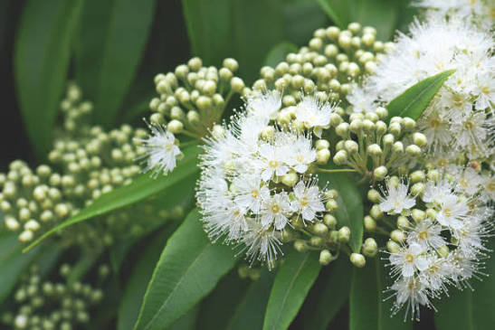
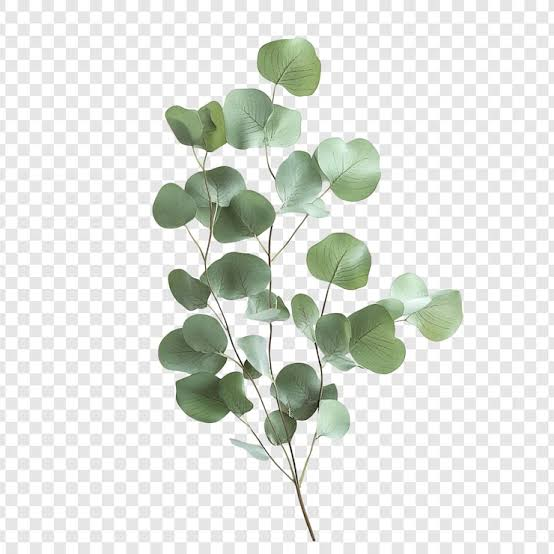
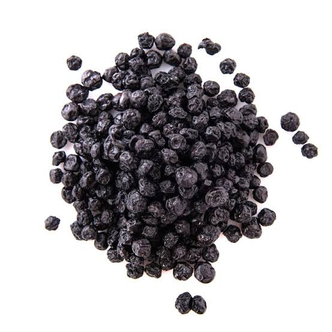
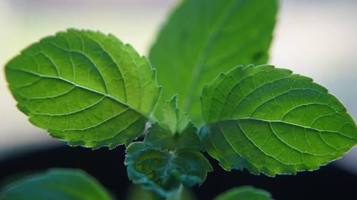

# Biogenic Volatile Organic Compounds (BVOCs)

## Required Plants
* Lemon
* Orange
* Lemon Myrtle
* Lavender
* Sweet Basil
* Mint
* Rosemary
* Sage
* Eucalyptus
* Black Pepper
* Clove
* Oregano
* Thyme
* Tulsi
* Cedar

---

### [Limonene & Citral]

* **Profile:** Bright, energetic, clean, and citrusy.
* **Sources:** Lemon, Orange, Lemon Myrtle.
* **Benefit:** Mood elevation, anti-anxiety agent; increases serotonin in the brain.
* **Target Emissions:** *d-Limonene*, *Citral*, and *Geranial*.
* **Biological Origin:** Synthesized and stored inside the **glandular oil sacs (flavedo)** of citrus rinds and the **microscopic oil glands** dotting the undersides of the leaves. High airflow across the leaves triggers passive release, while mild mechanical compression of the fruit rind forces active expression.

### [Linalool]

* **Profile:** Sweet, calming, floral, and herbal.
* **Sources:** Lavender, Sweet Basil, Mint.
* **Benefit:** Deep nervous system sedative; activates the parasympathetic nervous system for better sleep.
* **Target Emissions:** *Linalool* and *Linalyl acetate*.
* **Biological Origin:** Manufactured within the **capitate glandular trichomes** (tiny hair-like stalks with globose oil heads) covering the flower calyxes and leaf surfaces. Airflow must be gently warm or fast enough to rupture the thin outer membrane of these resin heads to maximize vaporization.

### [Eucalyptol]

* **Profile:** Camphorous, sharp, cooling, and fresh.
* **Sources:** Rosemary, Sage, Eucalyptus.
* **Benefit:** Respiratory clearer; opens up the airways, increases blood flow to the brain, and sharpens mental focus.
* **Target Emissions:** *1,8-Cineole (Eucalyptol)* and *Camphor*.
* **Biological Origin:** Excreted heavily into **subepidermal secretory cavities** embedded deep within the stiff, leathery leaf tissue. Because these storage cavities sit deep, the mini-vent system requires targeted velocity (higher CFM) to strip the boundary layer of the leaf and pull the deep compounds out.

### [Beta-Caryophyllene]

* **Profile:** Spicy, woody, and warm.
* **Sources:** Black Pepper, Clove, Oregano, Thyme.
* **Benefit:** Direct anti-inflammatory; interacts with the body's endocannabinoid system to reduce stress.
* **Target Emissions:** *Beta-Caryophyllene* and *Eugenol*.
* **Biological Origin:** Located in **internal oil ducts** within the dried flower buds (cloves), drupes (peppercorns), and **peltate trichomes** on herb leaves. For dry pods, air must pass *through* a crushed or porous spice bed. For living herbs, light mechanical rustling or air-flexing releases the compounds.

### [Alpha & Beta-Pinene]

* **Profile:** Fresh, piney, earthy, and deep woods.
* **Sources:** Tulsi, Cedar.
* **Benefit:** Immuno-stimulant; significantly boosts the count and activity of natural killer (NK) immune cells.
* **Target Emissions:** *Alpha-Pinene*, *Beta-Pinene*, and *Eugenol* (from Tulsi).
* **Biological Origin:** Generated inside **intercellular resin ducts** running parallel through conifer needles/wood chips, and **secretory glandular structures** across Tulsi leaves. Turbulent airflow through the dense needle/leaf canopy creates the shear force needed to lift these heavy molecules into the air stream.

---

##  Localization & Sourcing Notes 

To ensure this prototype remains highly accessible for builds within urban Indian environments, the following species-level adjustments are recommended for the physical hardware setup:

1. **Pine Alternative:** True temperate pine is substituted with **Tulsi (Holy Basil)**. Tulsi acts as a localized immunomodulatory powerhouse, offering exceptional airborne anti-microbial properties and terpene output easily suited for small indoor enclosures.
2. **Cedar Sourcing Strategy:** True Himalayan Cedar (*Cedrus deodara*) will not survive the heat of non-mountainous Indian urban climates. The prototype supports two functional replacements:
   * **Living Variant:** Use the highly resilient, easily accessible **Morpankhi plant** (*Thuja compacta*). It features a highly identical coniferous needle architecture, scales perfectly to desktop enclosures, and reacts cleanly to localized fan system airflow.
   * **Dry Cartridge Variant:** Use raw **Devdar (देवदार) heartwood chips/flakes**, widely available at local traditional apothecary or pooja stores, placed directly into the mechanical air-induction path.
